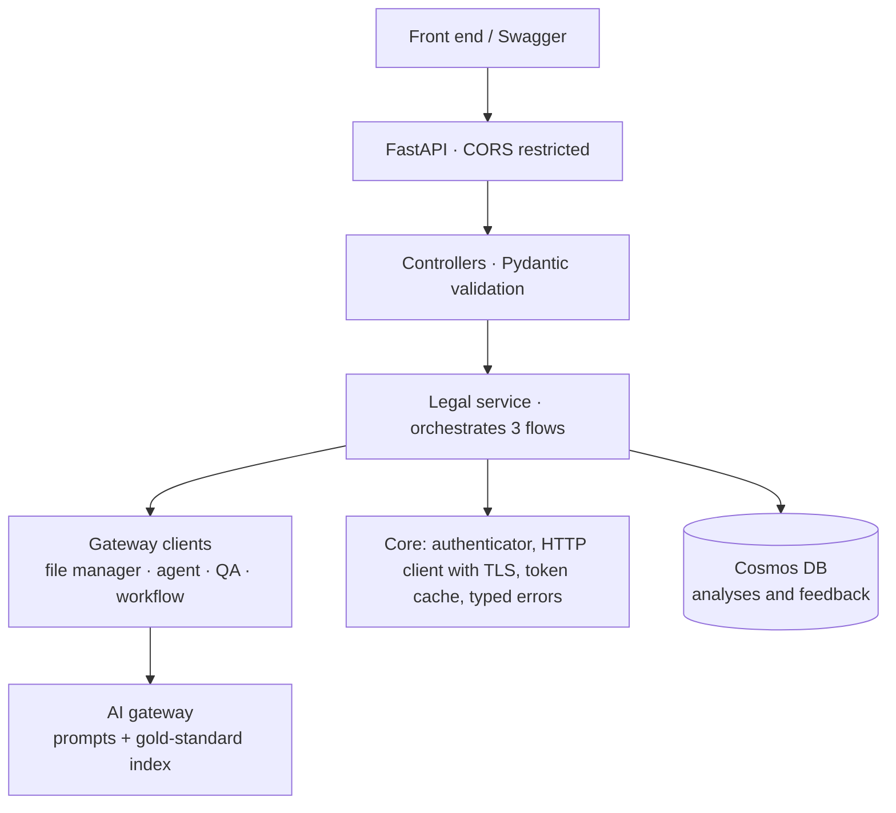

# Contract Comparison API

The production backend of the [contract comparison agent](https://github.com/lucasboliveirasipp/contract-comparison-agent): a FastAPI service that runs the three legal flows (gold standard vs draft, version diff, analysis chat) through the company's AI gateway and stores analyses and lawyer feedback in Cosmos DB.

**Stack:** Python · FastAPI · Pydantic · Azure Cosmos DB · OAuth2 client credentials · pytest (91 tests)
**Role:** Lead developer: design and implementation
**Status:** Backend phases 1–3 delivered

> Built at a large Brazilian insurer. The company is replaced by the fictional **Acme Seguros**, and every name, document and data point here is fictional. Code, prompts and UI are in Portuguese, written for Brazilian business teams.

## Problem

The Streamlit prototype proved the value, but it called the model provider directly and kept prompts in the app. Production rules required every AI call to go through the company's governed AI gateway, with authentication, auditability and a front end shared with other agents.

## What I built



- **Thin-gateway design:** prompts and the gold-standard index live in the gateway; the backend validates, orchestrates, persists and handles errors.
- **Typed errors and token caching** in a small core layer shared by all gateway clients.
- **History in Cosmos DB:** every analysis and every accept/reject/edit decision is stored, so reviews are auditable.
- **91 tests** with every external call mocked; they run without any keys.

Full write-up with trade-offs: [docs/CASE_STUDY.md](docs/CASE_STUDY.md)

## Run it

```bash
python -m venv .venv && .venv\Scripts\activate   # macOS/Linux: source .venv/bin/activate
pip install -r requirements.txt
pytest                                             # no keys needed
cp .env.example .env                               # gateway URL, Entra ID app, Cosmos DB
uvicorn src.main:app --reload                      # Swagger at /docs
```

---
Part of my [AI engineering portfolio](https://github.com/lucasboliveirasipp).
