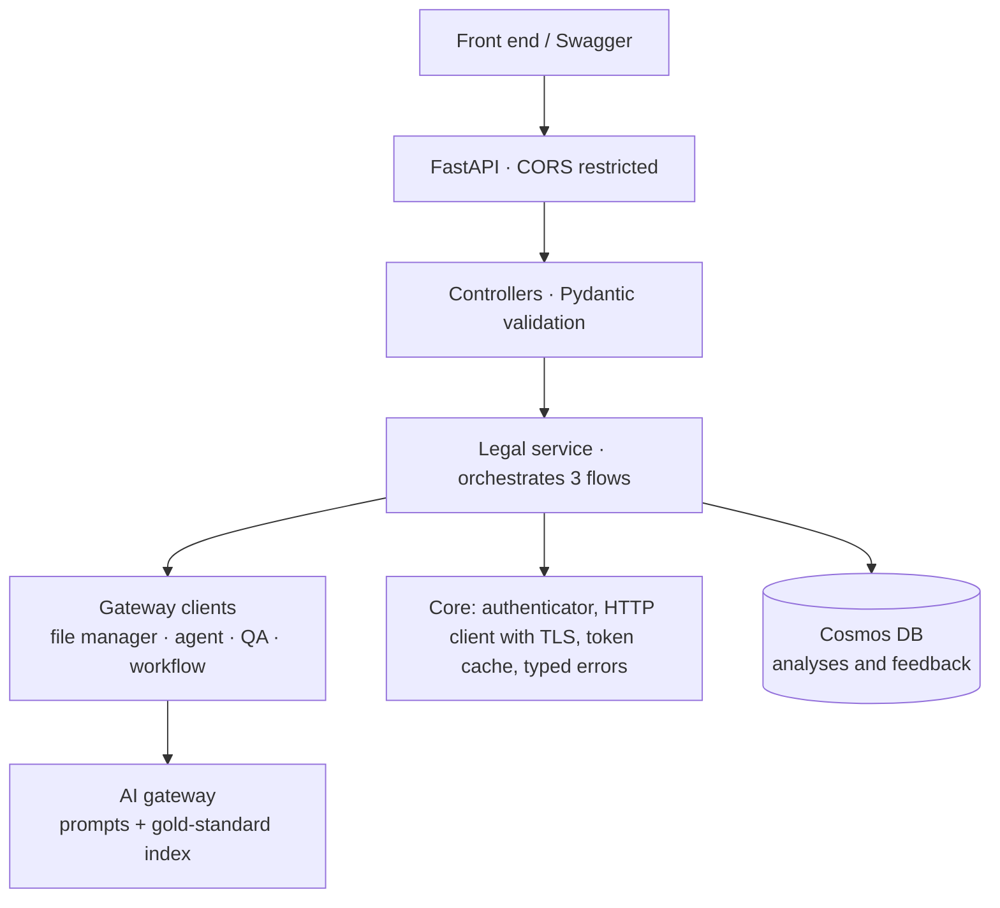

# Contract Comparison — case study

An assistant for the legal team that compares a supplier's contract draft with the company's standard clauses, tracks what changed between two versions of a contract, and answers follow-up questions. It started as a Streamlit prototype and became a FastAPI backend on the company's AI platform.

> Built at a large Brazilian insurer. Names, documents and data are fictional.

## Context

Lawyers reviewed supplier contracts clause by clause against the company's **gold-standard clauses** (the approved wording for liability, confidentiality, data protection, termination and so on). When a supplier sent back a modified version, they also had to find every change between the original and the new file. Both tasks were slow and easy to get wrong on long contracts.

## What it does

1. **Gold standard vs supplier draft:** finds each relevant standard clause by semantic search, compares it with the supplier's wording and classifies the impact of each difference, from the contracting company's point of view, with a suggested response.
2. **Original vs modified:** lists every change between two versions, with a summary.
3. **Analysis chat:** questions about the analysis just produced ("Is the liability cap acceptable?").
4. **Human in the loop:** lawyers accept, reject or edit each point; the feedback is stored with the analysis.
5. **Export:** the reviewed analysis goes to Word (with comments) or PDF.

## Two phases

**Phase 1 — prototype (Streamlit).** Talked directly to Azure OpenAI and MongoDB. It proved the value with the legal team and fixed the output format.

**Phase 2 — production backend (FastAPI).** Prompts and the gold-standard index moved into the company's AI gateway ("thin gateway" design). The backend handles validation, orchestration, persistence and errors.



## Key decisions and trade-offs

| Decision | Why | Trade-off |
|---|---|---|
| **Prototype first, then a thin backend** | The legal team validated the output on real contracts before any platform work | Some logic was rewritten during the migration |
| **Prompts and the semantic index live in the gateway** | Prompt changes don't need a backend deploy, and governance is central | The backend can't be fully tested end to end without the gateway, so every gateway call is mocked |
| **Two connection modes per request** (OAuth2 client credentials via API Management, or mTLS service login) | Different environments exposed the AI services differently | Two auth paths to test and maintain |
| **One HTTP helper for every outbound call**, with TLS always on, masked `Authorization` headers and a token cache with TTL | Lessons from an earlier code review: duplicated GET calls and disabled TLS verification | Slightly more abstraction for simple calls |
| Original-vs-modified runs as an **async workflow with polling** | Long contracts exceed a normal request timeout | The client has to poll |

## Quality

- **91 automated tests**; every gateway and Cosmos DB call is mocked.
- Coverage target of 80% minimum.
- Security checklist: TLS on, secrets outside the code, CORS restricted, no stack traces in responses, masked auth headers.

## Illustrative snippet

```python
@router.post("/compare/versions", response_model=VersionComparison)
async def compare_versions(original: UploadFile, modified: UploadFile,
                           connection_mode: Literal["APIM", "GATEWAY"] = Query("APIM")):
    ids = [await files.upload(f, connection_mode) for f in (original, modified)]
    run = await workflows.start("contract-versions", ids, connection_mode)
    result = await workflows.wait(run.id, timeout_s=300)      # polls the status endpoint
    analysis = VersionComparison.model_validate(result.output)
    await store.save(analysis)
    return analysis
```

## Stack

Python · FastAPI · Pydantic · Azure Cosmos DB · Azure API Management · OAuth2 / mTLS · pytest · Streamlit, LangChain and MongoDB in the prototype · python-docx · ReportLab
